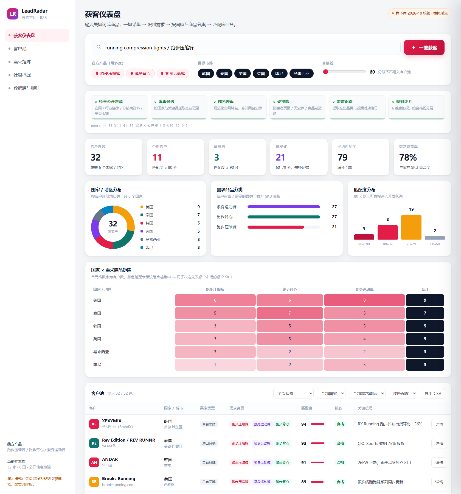
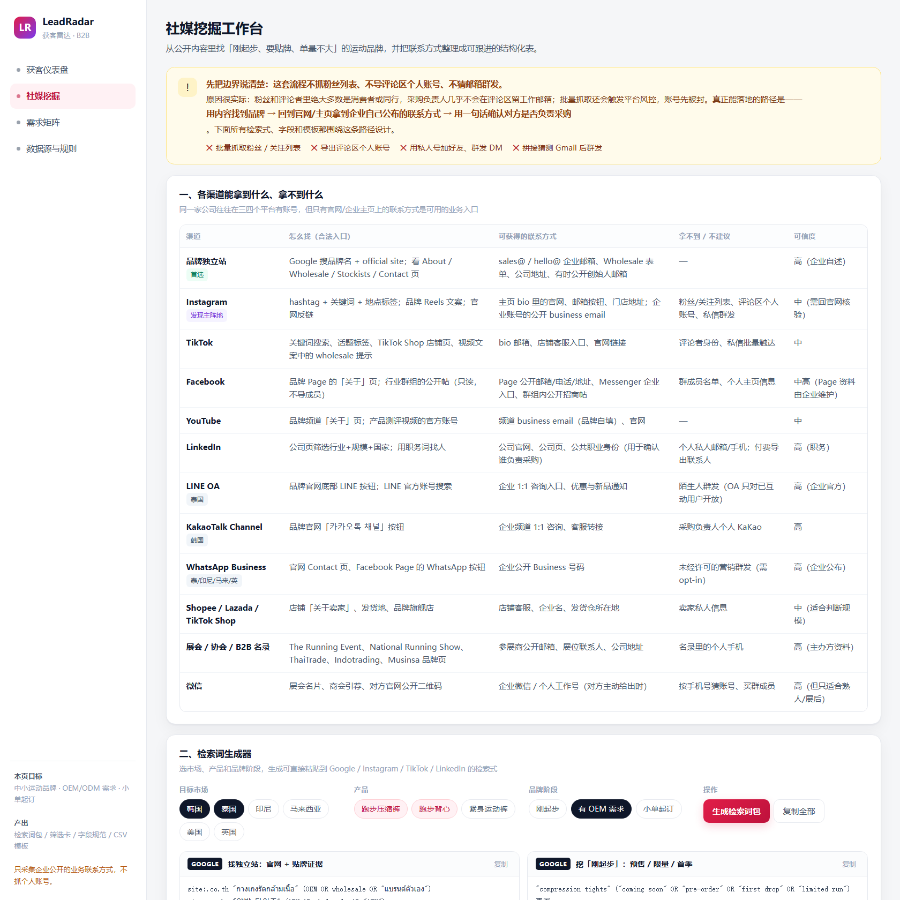
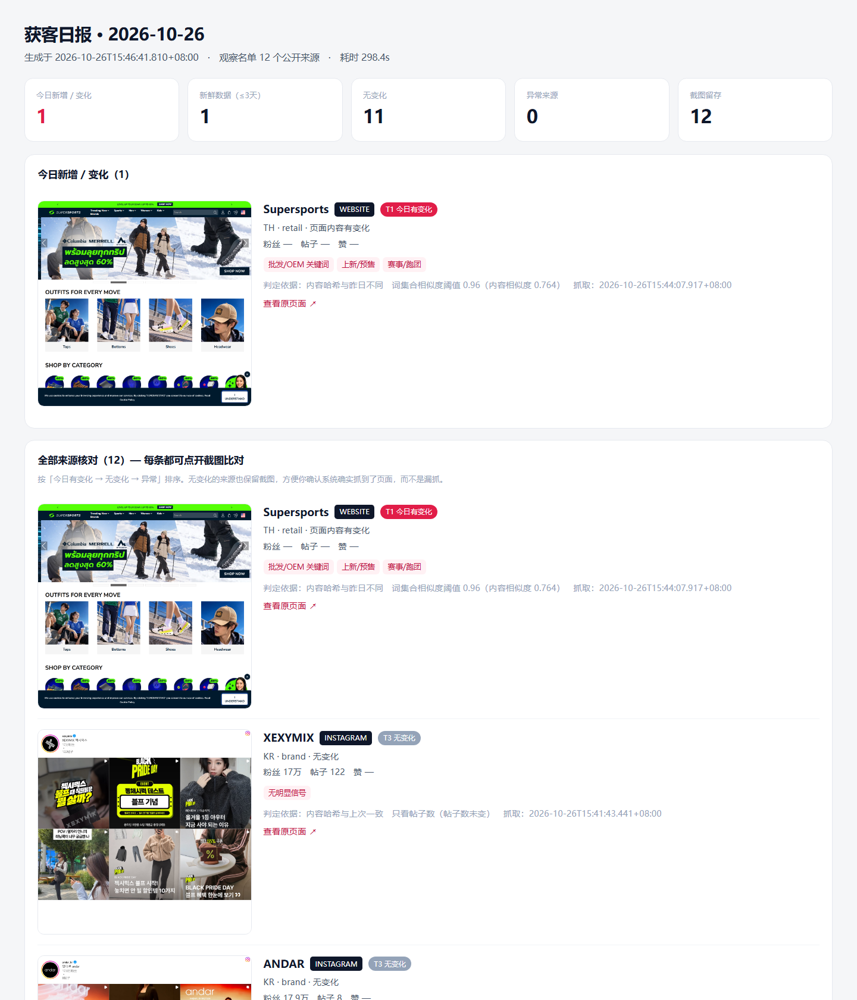

# LeadRadar 获客雷达

面向**跑步服饰出口**的 B2B 获客系统：一个可交互的客户开发仪表盘、一套社媒挖掘检索方案、一个每天定时（默认 10:00:00，精确到秒）自动运行的**真实获客流水线**（搜索发现 + 联系方式挖掘 + AI 判断写开发信 + 日报推送）。

产品背景：跑步压缩裤 / 跑步背心 / 紧身运动裤，面向韩国、泰国、美国、英国、印尼、马来西亚六个市场的中小型运动品牌。



---

## 真实获客流水线（v2，告别「水名单」）

> **新手看这里**：`docs/配置与部署指南.md` 是傻瓜版「注册 key + 配代理」步骤，照着做即可。

v1 的仪表盘是演示原型（`const DATA` 写死 10 家公司，「一键获客」只是本地过滤打分，不发请求）。v2 新增一条**真实**流水线：

```
真实搜索发现 → 官网/社媒挖联系方式 → AI 判断 + 100 分评分去重 → 日报(含邮箱/电话/社媒/开发信) → 每日定时推送(精确到秒)
```

新增文件：

| 文件 | 作用 |
|---|---|
| `config.json` | 所有配置：定时时间、市场/商品、搜索与邮箱/大模型 API key |
| `run.mjs` | 跑一次完整获客，输出 `out/<日期>/report.html` |
| `console/server.mjs` | **操作台**：浏览器里点按钮跑任务、填 key、看报告（本地 127.0.0.1:7788） |
| `doctor.mjs` | **环境体检**：一条命令说清现在能跑到什么程度、缺什么 |
| `scheduler.mjs` | 内置定时器，一个进程管两条链路（09:30 采集 + 10:00 获客，精确到秒） |
| `src/schedule.mjs` | 时区安全的「下次执行时刻」计算，定时器/操作台/体检共用一份口径 |
| `src/search.mjs` | 搜索统一接口：Serper(Google) / Bing / Google CSE，填 key 即用 |
| `src/enrich.mjs` | 官网挖邮箱/电话/社媒/LINE/Kakao + 邮箱查找 API 兜底 |
| `src/social.mjs` | 社媒线索发现：搜到 IG/TikTok/FB 品牌主页 → 读公开简介 → 挖 bio 里的官网/邮箱 |
| `src/llm.mjs` | 大模型：AI 判断买家/定制需求 + 自动写开发信草稿（OpenAI 兼容，DeepSeek/通义/智谱/Kimi 都行） |
| `src/net.mjs` | 统一代理支持（`proxy` 配置 / `HTTPS_PROXY`，访问海外站点用） |
| `src/report.mjs` | 生成日报 + 通知（Windows 弹窗 / Linux notify-send / Webhook 推送） |

联系方式分两类：`(官方)` = 来自客户官网/公开页面，可信；`(候选)` = 邮箱查找服务推测，需验证后再用。

---

## 这个项目解决什么问题

外贸获客最常见的两个坑：

1. **名单很多，能跟的很少** —— 从展会名录、B2B 平台导出的几千条邮箱，打开率不到 1%，因为大部分不是采购方。
2. **每天重复劳动** —— 手动刷 Instagram、TikTok、官网，看不出「今天到底有什么新变化」，最后变成凭感觉发开发信。

LeadRadar 的做法是把获客拆成三段，每段都有明确的产出物和判断标准：

| 模块 | 解决的问题 | 产出 |
|---|---|---|
| 获客仪表盘 | 这家公司值不值得跟？ | 100 分制评分 + 国家/商品分类 + 匹配度 |
| 社媒挖掘工作台 | 去哪里找这类公司？ | 6 国 × 3 产品的检索词包 + 筛选卡 + 字段规范 |
| 每日采集任务 | 今天有什么新变化？ | 带截图的日报，只报真变化 |

---

## 三个模块

### 1. 获客仪表盘 `lead-radar/index.html`

单文件应用，无依赖，双击就能用。

- 输入关键词 / 勾选产品与市场 → 「一键获客」→ 6 步流水线 → 出结果
- KPI：客户总数、合格客户、高意向、待复核、平均匹配度、需求覆盖率
- 图表：国家分布环图、需求商品条形图、匹配度直方图、国家 × 商品矩阵
- 客户池：按状态/国家/商品筛选，按匹配度/国家/公司名排序，支持导出 CSV
- 详情抽屉：为什么判定有真实需求、6 维评分明细、近期信号、建议首触达



### 2. 社媒挖掘工作台 `lead-radar/social-sourcing.html`

针对「刚起步、有 OEM/ODM 需求、单次订单量不大」的中小运动品牌：

- **渠道能力矩阵**：12 个渠道分别能拿到什么联系方式、拿不到什么、可信度几级
- **检索词生成器**：选市场 / 产品 / 品牌阶段，实时生成 Google 高级检索式、Instagram 话题矩阵、TikTok 关键词、LinkedIn 组合、本地语言词（韩/泰/印尼/马来）
- **评论区与视频的正确用法**：只做线索层，不做名单层
- **100 分筛选卡**：品类契合 25 / 品牌阶段 15 / OEM 证据 20 / 单量匹配 15 / 内容活跃 10 / 决策人可触达 10 / 证据强度 5
- **字段规范 + CSV 模板**：公司表 27 列 + 联系人表 17 列，可直接下载

### 3. 每日采集任务 `daily/run.mjs`

每天 09:30 运行（由 `scheduler.mjs` 与获客流水线一起调度），抓取观察名单里的公开页面，判断「今天是否真的更新」，并留下可核对的截图。

```bash
node daily/run.mjs                 # 采集今天
node daily/run.mjs --date 2026-10-27   # 指定日期（用于补跑）
```

产物在 `daily/out/<YYYY-MM-DD>/`：

| 文件 | 内容 |
|---|---|
| `report.html` | 主报告：KPI + 每个来源的截图 + 判定依据 |
| `report.md` | 纯文本版 |
| `data.json` | 全字段结构化数据 |
| `leads.csv` | 16 列，UTF-8 BOM，Excel 直接打开 |
| `screenshots/` | `{channel}-{source-id}.png` |



---

## 评分模型（100 分制）

| 维度 | 分值 | 判断依据 |
|---|---:|---|
| 产品需求匹配 | 25 | 命中 1 个核心 SKU 15 / 2 个 20 / 3 个以上 25 |
| 买家角色 | 20 | 自有品牌 20 / 进口分销 19 / 专业零售 17 / 赛事定制 15 / 品牌+制造 11 |
| 地区 | 10 | 是否在目标市场（域名/关键词核实，猜的只给 5） |
| 商业就绪度 | 12 | 官网、社媒、联系方式、规模 |
| 近期活动 | 10 | 上新、赞助、扩张等信号数量 |
| 定制/OEM 需求 | 13 | 官网出现定制/贴牌/OEM/ODM 信号 13；品牌/分销/赛事默认 8；纯零售 2 |
| 证据强度 | 10 | 官方页面 > 行业媒体 > 目录 |

≥ 80 合格，60–79 待复核，< 60 不进客户池。评分随勾选的产品组合动态变化。「定制/OEM 需求」是跑服出口的核心卖点维度，直接把「可定制 LOGO/版型」的客户顶到前面。

> 仪表盘（`lead-radar/index.html`）与流水线（`src/score.mjs`）现在用**同一套七维模型**，同一条线索在两边分数一致。仪表盘样本库里的公司都没在公开页面上写贴牌/OEM 字样，所以那条维度在演示里只拿 8 或 2 分——这是刻意的：不为了好看编造证据。跑真实流水线时，页面出现 `private label` / `OEM` / `贴牌` 才会拿到 13 分。

---

## 新鲜度判定（每日采集）

不是看「页面能不能打开」，而是看**这次抓到的内容与上一次是否真的不同**。三级判定：

**第一级：页面自带发布时间**（JSON-LD / meta / `<time>` / RSS）

| 档位 | 含义 |
|---|---|
| T0 | 2 小时内 |
| T1 | 24 小时内 |
| T2 | 3 天内 |
| T3 | 超过 3 天，不计入新增 |

**第二级：没有发布时间时，按渠道看变化信号**

| 渠道 | 判定规则 | 原因 |
|---|---|---|
| Instagram | 只看帖子数是否变化 | 粉丝数、点赞数每秒都在变 |
| TikTok | 只看作品数变化；话题页仅作参考 | 同上，话题页是动态流 |
| 官网 | 词集合 Jaccard 相似度 < 0.96 | 轮播/推荐位会变，用词基本不变 |

**第三级：台账去重**
`daily/state/ledger.json` 记录每个来源的 `first_seen / last_hash / last_posts / last_tokens`。只有「首次纳入」或「判定有变化」才算当天新增。

> 首次运行会标成「基线建库」，不会冒充「今日新增」。**0 新增是有效结论**，不是失败。

---

## 操作台（本地控制面板）

不想敲命令就用这个：它能真正触发任务，不是假按钮。

```bash
node console/server.mjs        # → http://127.0.0.1:7788
```

Windows 上也可以直接双击 `start-console.cmd`（自动开服务 + 开浏览器）。

### 打包成单文件 EXE

```bash
npm i --no-save postject      # 只需一次，注入 SEA blob 用
npm run build:exe             # → dist/LeadRadar获客雷达.exe，并自动复制到桌面
npm run build:exe -- --no-desktop   # 只留在 dist/
```

产物约 84 MB（内含 node 运行时，**目标机器无需安装 Node**）。双击后：

1. 首次运行把源码解压到 `%LOCALAPPDATA%\LeadRadar\app`（之后复用，版本变了才重解压）
2. 起本地服务并自动打开 `http://127.0.0.1:7788#setup`
3. 首次没有 key 时页面自动滚到「密钥与代理」并聚焦输入框
4. 窗口开着时内置定时器生效（09:30 采集 / 10:00 获客），关窗口即停
5. 重复双击不会起第二个实例，只会打开浏览器

> 原理：Node SEA（Single Executable Application）。源码以 base64 内嵌在启动器里注入 `node.exe`；
> SEA 里 `require` 外部文件不可用但动态 `import()` 可用，所以子任务用 `EXE --job <kind>` 自调用。

- **执行**：跑一次获客 / 跑一次每日采集 / 环境体检 / 看下次运行时间，日志实时回流，可中途停止
- **密钥与代理**：直接在页面上填 Serper / 大模型 / 代理，保存即写入 `.env`，下一轮任务生效；回显为掩码
- **历史报告**：列出 `out/` 与 `daily/out/` 下所有日报，支持内嵌预览和新窗口打开
- **定时器与自启**：给出常驻 / 注册自启命令，一键复制

边界：只监听 `127.0.0.1`（非本机请求一律 403），只能读项目目录内的报告文件，**没有任何发信能力**。

### 换检索词（不用改代码）

操作台里的「检索词」卡片，是唯一需要调优的入口：

| 项 | 说明 |
|---|---|
| 检索式模板 | 一行一条，如 `{product} {buyer} {country}`。模板在外层、产品×市场在内层，所以预算被截断时每个组合至少保住一条 |
| 占位符 | `{product}` 产品词、`{buyer}` 买家类型词、`{country}` 国家词 |
| 自定义检索式 | 一行一条，**原样发出**。写本地语（`러닝 레깅스 도매`）和 `site:` 限定的唯一入口 |
| 追加/替换 | 追加=先跑自定义再跑模板；替换=只用自定义（模板不跑，自定义为空时自动回退模板，避免跑空） |
| 每轮上限 | 含社媒检索式在内，按次计费 |
| 词表 | 产品/国家/买家三张表，留空即用内置默认 |

保存后写进 `config.json` 的 `search.*`，下一轮生效；卡片底部实时显示「当前生效 N 条 / 生成了 M 条，截断 X 条」和前 8 条预览。「恢复默认」一键清空所有覆盖。

> 打包成 EXE 后，`config.json` 不会被当作内置资源覆盖——升级程序不会冲掉你调好的词表和 key。

---

## 快速开始

```bash
# 0. 环境：Node ≥ 18（已装），零第三方依赖，无需 npm install

# 1. 体检：先看现在能跑到什么程度、缺什么（不花任何额度）
node doctor.mjs

# 2. 操作台（推荐）：浏览器里点按钮跑任务、填 key、看报告
node console/server.mjs          # → http://127.0.0.1:7788

# 3. 填 key（不填也能跑，会退化为「官网/社媒公开信息」模式）
#    复制 .env.example 为 .env 后填，详见 docs/配置与部署指南.md：
#      SERPER_API_KEY=xxx        # 搜索（推荐 serper.dev）
#      LLM_API_KEY=sk-xxx        # 大模型（推荐 deepseek）
#      HTTPS_PROXY=http://127.0.0.1:7890   # 访问 IG/TikTok 用
#    提示：操作台里可以直接填，保存即写入 .env，下一轮任务生效

# 4. 跑一次看效果
node run.mjs

# 5. 查看下次运行时间（默认 09:30 采集 / 10:00 获客，可精确到秒）
node scheduler.mjs --next

# 6. 启动内置定时器（前台常驻，Ctrl+C 退出；一个进程管两条链路）
node scheduler.mjs

# 7. 注册开机自启（自动识别系统：Windows→计划任务，Ubuntu→生成 systemd 服务）
node scheduler.mjs --register-task

# 8. 手动单次 / 立即执行一次后进入每日循环
node scheduler.mjs --once           # 只跑获客流水线
node scheduler.mjs --daily          # 只跑每日采集
node scheduler.mjs --now            # 立即跑获客，然后进入每日循环
```

> 修改每天推送时间：编辑 `config.json` 的 `schedule.daily`（格式 `HH:MM:SS`，如 `"10:00:00"`、`"09:30:15"`）。时区由 `schedule.timezone` 控制（默认 `Asia/Shanghai`），**按北京时间计算，跟服务器本地时区无关**——Ubuntu 云服务器哪怕是 UTC，也照样每天北京时间 10 点跑。

环境要求（Windows 与 Ubuntu 通用）：

- Node.js ≥ 18（只用原生 `fetch`，零第三方依赖）
- 能访问搜索 API 与目标官网；Instagram / TikTok 等海外社媒需代理网络
- Chrome 可选：仅当 `contacts.use_chrome_fallback=true` 时用于抓取 JS 渲染页面

### 部署到 Ubuntu 云服务器

```bash
# 1. 上传项目后安装 Node ≥ 18（已装则跳过）
# 2. 填 key
cp .env.example .env && vim .env

# 3. 注册开机自启（自动生成 leadradar.service 并打印安装命令）
node scheduler.mjs --register-task
#    按提示执行：sudo cp leadradar.service /etc/systemd/system/ && \
#    sudo systemctl daemon-reload && sudo systemctl enable --now leadradar

# 4. 看日志 / 状态
journalctl -u leadradar -f
systemctl status leadradar
```

> 云服务器没有桌面，弹窗通知失效。把日报「推」到手机/微信：编辑 `config.json` 的 `report.notify` 与 `report.webhook_url`，填一个企业微信群机器人 / 钉钉机器人的 Webhook 地址，每天跑完自动推送文字摘要。

---

## 目录结构

```
.
├── lead-radar/
│   ├── index.html              # 获客仪表盘（单文件）
│   └── social-sourcing.html    # 社媒挖掘工作台（单文件）
├── daily/
│   ├── sources.json            # 观察名单（12 个来源）
│   ├── run.mjs                 # 采集脚本
│   ├── state/ledger.json       # 变化台账（运行时生成）
│   └── out/YYYY-MM-DD/         # 每日产物（运行时生成）
├── exports/                    # 市场调研与首批客户名单
├── docs/screenshots/           # README 截图
└── wm-report.json              # 报告数据源
```

### 添加观察来源

编辑 `daily/sources.json`：

```json
{
  "id": "ig-example",
  "channel": "instagram",
  "name": "Example Brand",
  "handle": "example.brand",
  "country": "TH",
  "type": "brand",
  "products": "compression_tights;singlet"
}
```

`channel` 支持 `instagram` / `tiktok` / `website`；`tiktok` 的 `handle` 填 `tag/xxx` 表示话题页。

---

## 数据与边界

这个项目刻意划了几条线，写在代码里也写在文档里：

- **只采集公开信息**：官网、企业主页、行业媒体、上市公司披露。
- **不抓粉丝列表 / 关注列表 / 评论区个人账号**，不做批量私信。这类数据既违反平台条款，转化率也极低。
- **不猜测邮箱**：`pattern_inferred` 只能标为候选，不能当已确认联系方式。
- **不自动发送**：系统只做采集、判断、报告，所有触达都需要人工确认。
- **截图只覆盖无需登录的公开页面**：登录后才可见的内容不做抓取；Instagram 部分账号会弹「注册以查看更多」浮层，属平台对未登录访问的默认行为。
- **仓库内不含任何真实联系人邮箱、电话或私人账号**。

---

## 已知限制

1. 采集基于**内置观察名单**，不是全网爬虫。想扩容改 `sources.json`。
2. 依赖本机安装的 Chrome；CI 环境需要额外配置。
3. 定时器是**项目自带的进程内循环**（`scheduler.mjs`），一个进程管 09:30 采集 + 10:00 获客两条链路；必须前台常驻或注册开机自启，电脑关机/服务器停机期间不补跑。
4. 官网相似度阈值 0.96 是经验值：轮播改版会误报，真实上新一般会掉到 0.8 以下。
5. Instagram 的粉丝数/帖子数依赖公开页面文本，部分账号结构不同会取不到。

v2 流水线已知边界：

1. 真实搜索需要 API key（Serper / Bing / Google CSE），未填时退化为本地样本库的官网/社媒公开信息抓取。
2. 搜索有预算上限：`search.max_queries_per_run`（默认 30）是**含社媒检索式在内的全局上限**，超出部分不会静默丢弃，日志里会打印实际生成数与截断数。
3. 检索失败不再静默：失败条数会进日报警告区；全部失败时会明确提示「报告为空不代表没有客户」，避免 key 失效却产出一份漂亮空报告。
4. 邮箱优先保留「同域名」邮箱（如 `@company.co.kr`），第三方服务邮箱自动过滤；找不到同域名邮箱时才保留原文，需人工甄别。
5. 电话只从 `tel:` 链接和 `+` 开头的国际格式提取，宁可少报、不报错号。
6. 邮箱查找 API（Hunter/Apollo/Snov）与 AI 判断/开发信需要对应 key，返回的「推测邮箱」统一标注 `(候选)`，发信前需验证。
7. 社媒链路只做公开主页线索发现，不做批量私信/抓粉（违反平台条款）。LinkedIn 刻意不进自动流水线（个人主页在登录墙后），只作为社媒工作台里的人工找人工具。
8. 定时器是进程内循环：前台运行或注册开机自启，电脑/服务器关机期间不补跑。
9. **思考型模型要留足 token**：`deepseek-reasoner` / `deepseek-flash` / `o1` 这类模型的思考过程计入 `max_tokens`，额度小时正文会为空。默认预算 4000，可用 `LLM_MAX_TOKENS` 调到 8000；报错会明确写「finish_reason=length / 返回空内容」而不是含糊的「JSON 解析失败」。
10. AI 调用默认走 `response_format: json_object`（服务商不支持时自动降级重试一次）；解析失败会自动降温度重试一次，仍失败才计入日报警告区，并带上真实原因。

---

## Roadmap

- [x] 操作台（本地控制面板）：跑任务 / 填 key / 看报告 / 复制自启命令
- [x] 定时器统一调度：一个进程管「09:30 采集 + 10:00 获客」
- [x] 环境体检 `doctor.mjs`：一条命令说清缺什么
- [x] 仪表盘与流水线统一为同一套七维评分模型
- [ ] 接入 Google Custom Search / Bing Web Search API，替换内置样本库
- [ ] 观察名单扩到 30 个来源，按国家分组统计
- [ ] 采集结果直接写入 CRM 表结构（companies / contacts）
- [ ] 日报增加「本周趋势」与「首次出现的新品牌」
- [ ] Playwright 替代 Chrome CLI，支持点击「加载更多」

---

## 说明

样本库中的公司信息来自公开可查的企业官网、行业媒体与上市公司披露，核验日期 2026-10。所有「需求商品」「近期信号」均为基于公开在售品类与内容的**推断**，不代表在手采购计划。

本项目仅用于获客研究与流程演示，不构成对任何公司的商业评价。
